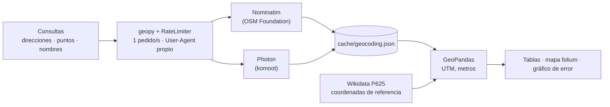

# Geocoding

[](requirements.txt) [](LICENSE)

**De direcciones a coordenadas y de vuelta con geocodificadores gratuitos de OpenStreetMap, y una medición de cuánto pueden errar: Nominatim vs Photon en 10 lugares de Tokio, error en metros contra Wikidata.**


Dos notebooks cortos con `geopy`, sin API keys, a no más de 1 pedido por segundo. Los notebooks están en inglés. *Read in [English](README.md).*

| Notebook | Qué hace | Colab |
|---|---|---|
| [01 · Intro a la geocodificación](Notebook/01_Intro_To_Geocoding.ipynb) | Directa (3 museos de Madrid, texto libre vs consulta estructurada) e inversa (6 puntos, completitud de la dirección), con mapa | [](https://colab.research.google.com/github/oechenique/Geocoding/blob/main/Notebook/01_Intro_To_Geocoding.ipynb) |
| [02 · Nominatim vs Photon](Notebook/02_Geocoding_With_Apis.ipynb) | Los mismos 10 lugares de Tokio con los dos, error en metros (UTM 54N) contra las coordenadas de Wikidata | [](https://colab.research.google.com/github/oechenique/Geocoding/blob/main/Notebook/02_Geocoding_With_Apis.ipynb) |

## Arquitectura



Cada pedido pasa por un `RateLimiter` (1 s entre llamadas, 2 reintentos) con un User-Agent que nombra este repo, como pide la [política de uso de Nominatim](https://operations.osmfoundation.org/policies/nominatim/). Las respuestas quedan en un cache en disco: volver a correr un notebook no manda pedidos. Las distancias se calculan en un CRS métrico (UTM), nunca en grados.

## Qué demuestra

- **Nominatim encontró 9 de 10 lugares de Tokio, con error mediano de 18 m**; el peor, 225 m (la estación de Tokio, un edificio de más de 300 m de largo). No encontró el edificio del Gobierno Metropolitano ([notebook 02](Notebook/02_Geocoding_With_Apis.ipynb)).
- **Photon encontró 10 de 10, con mediana de 21,5 m, pero 3 respuestas son otro lugar**: Meiji Jingū → el estadio de béisbol Meiji Jingū (1,6 km), la estación de Tokio → la estación Tokyo Teleport (6,0 km), Kabuki-za → el Theater Milano-Za de Shinjuku (6,8 km). El matching difuso encuentra más y se equivoca más.
- **Sin número de puerta vuelve la calle, no el edificio**: "Paseo del Prado, 28014 Madrid" cae en la calle, y la respuesta en texto libre y la estructurada eligen tramos a **672 m** uno del otro; con número (Reina Sofía, Thyssen) coinciden a **0 m** ([notebook 01](Notebook/01_Intro_To_Geocoding.ipynb)).
- **Geocodificación inversa de 6 puntos de Madrid**: calle, código postal y ciudad volvieron 6/6; número de puerta 4/6 (un parque y una estación no tienen); barrio 3/6.

## Decisiones y lo que aprendí

- **Medir contra una referencia, no contra la confianza del geocodificador.** Photon devolvió una respuesta creíble para los 10; solo la distancia a Wikidata muestra que 3 están mal.
- **Las coordenadas de referencia están fijas en el notebook, con su QID**, en vez de bajarse al correr: si alguien edita Wikidata, la comparación no se mueve.
- **Mismas rutas que antes** (`Notebook/01_…`, `Notebook/02_…`), para que los links viejos de Colab sigan andando; las versiones de 2024, que definían funciones y nunca las llamaban, están en [`legacy/`](legacy/).
- **Sin mapa de fondo en la figura.** Los tiles de CARTO ahora piden API key y los servidores de tiles de OSM bloquean el User-Agent por defecto de contextily (403; se evita desde contextily 1.7 con `headers={"user-agent": ...}`, ver [contextily#286](https://github.com/geopandas/contextily/issues/286)); a escala de ciudad, un gráfico de barras del error dice más que un mapa.

## Límites y lo que haría en un caso real

- 10 lugares son una muestra, no un benchmark: los números dependen de cómo está mapeado cada lugar en OSM.
- Wikidata pone un punto por ítem; en lugares grandes (un santuario con bosque, una estación) no hay un único punto correcto.
- Los servidores públicos de Nominatim y Photon son para uso liviano. Para miles de direcciones: instancia propia (los dos tienen imagen de Docker) o una API paga, más un control de calidad como el del notebook 02.
- Solo probé nombres en inglés + ", Tokyo"; con nombres en japonés o consultas estructuradas el resultado probablemente cambie.

## Stack por capa

| Capa | Tecnología |
|---|---|
| Geocodificación | `geopy` 2.5 (Nominatim, Photon, `RateLimiter`) |
| Geometría y distancias | `geopandas`, `shapely`, `pyproj` (UTM) |
| Mapas y figuras | `folium` vía `GeoDataFrame.explore()`, `matplotlib` |

## Estructura del repo

| Carpeta | Qué hay |
|---|---|
| `Notebook/` | Los dos notebooks (mismas rutas que la versión original) |
| `docs/img/` | La figura de este README, que escribe el notebook 02 |
| `legacy/` | Los notebooks de 2024 y capturas de los de 2023, con una [nota](legacy/README.md) |

## Cómo reproducirlo

En Colab: clic en un badge de arriba. Local (probado en Windows 11 + PowerShell, Python 3.12.10):

```powershell
python -m venv .venv
.venv\Scripts\python.exe -m pip install -r requirements.txt
.venv\Scripts\python.exe -m jupyter lab
```

La primera corrida manda 12 pedidos a Nominatim (notebook 01) y 20 a Nominatim/Photon (notebook 02), menos de un minuto; las siguientes leen `Notebook/cache/`.

## Licencias y atribución

- Código: [MIT](LICENSE).
- Resultados de geocodificación: © [colaboradores de OpenStreetMap](https://www.openstreetmap.org/copyright), [ODbL](https://opendatacommons.org/licenses/odbl/), servidos por [Nominatim](https://nominatim.org/) y [Photon](https://photon.komoot.io/).
- Coordenadas de referencia: [Wikidata](https://www.wikidata.org/), CC0.
