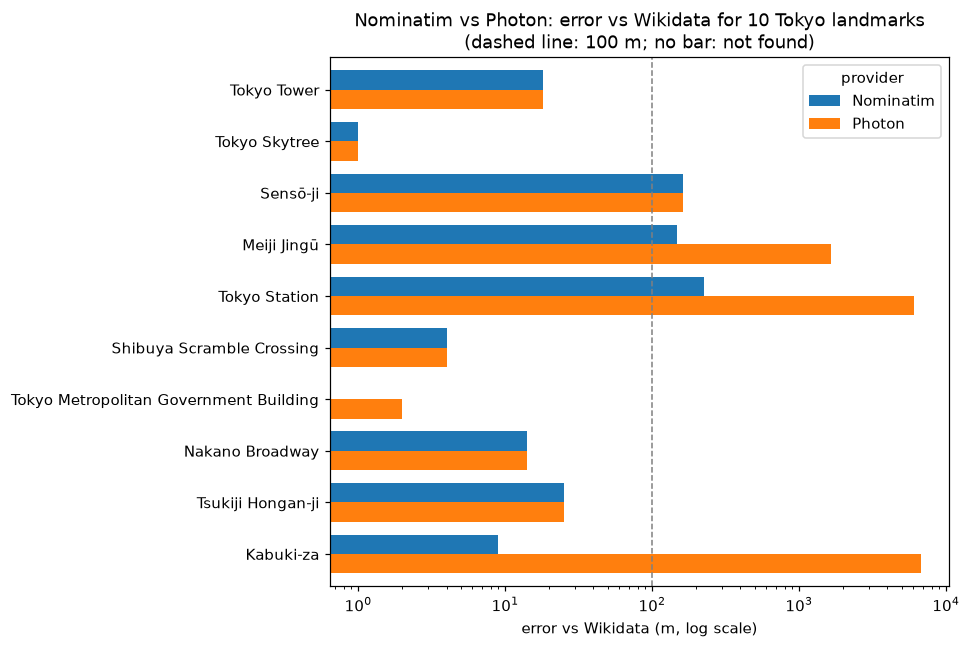
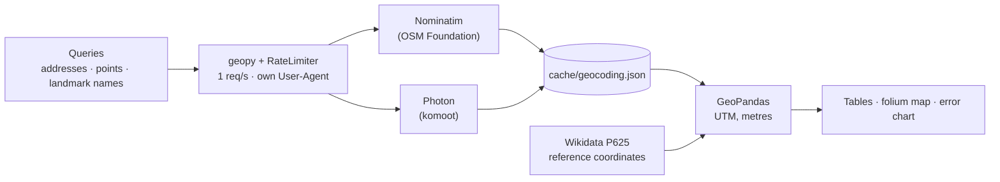

# Geocoding

[](requirements.txt) [](LICENSE)

**Addresses to coordinates and back with free OpenStreetMap geocoders, and a measurement of how wrong they can be: Nominatim vs Photon on 10 Tokyo landmarks, error in metres against Wikidata.**



Two short notebooks with `geopy`, no API keys, at most 1 request per second. *Leer en [español](README.es.md).*

| Notebook | What it does | Colab |
|---|---|---|
| [01 · Intro to geocoding](Notebook/01_Intro_To_Geocoding.ipynb) | Forward (3 Madrid museums, free text vs structured query) and reverse (6 points, address completeness), on a map | [](https://colab.research.google.com/github/oechenique/Geocoding/blob/main/Notebook/01_Intro_To_Geocoding.ipynb) |
| [02 · Nominatim vs Photon](Notebook/02_Geocoding_With_Apis.ipynb) | Same 10 Tokyo landmarks with both geocoders, error in metres (UTM 54N) against Wikidata coordinates | [](https://colab.research.google.com/github/oechenique/Geocoding/blob/main/Notebook/02_Geocoding_With_Apis.ipynb) |

## Architecture



Every request goes through a `RateLimiter` (1 s between calls, 2 retries) with a User-Agent that names this repo, as the [Nominatim usage policy](https://operations.osmfoundation.org/policies/nominatim/) asks. Answers are cached on disk, so re-running a notebook sends no requests. Distances are computed in a metric CRS (UTM), never in degrees.

## What it shows

- **Nominatim found 9 of 10 Tokyo landmarks, median error 18 m**, worst 225 m (Tokyo Station, a building over 300 m long). It missed the Tokyo Metropolitan Government Building ([notebook 02](Notebook/02_Geocoding_With_Apis.ipynb)).
- **Photon found 10 of 10, median 21.5 m, but 3 answers are a different place**: Meiji Jingū → the Meiji Jingū baseball stadium (1.6 km off), Tokyo Station → Tokyo Teleport station (6.0 km), Kabuki-za → Theater Milano-Za in Shinjuku (6.8 km). Fuzzy matching finds more and is wrong more.
- **A query without a house number returns the street, not the building**: "Paseo del Prado, 28014 Madrid" lands on the street, and the free-text and structured answers pick segments **672 m apart**; with a house number (Reina Sofía, Thyssen) they agree to **0 m** ([notebook 01](Notebook/01_Intro_To_Geocoding.ipynb)).
- **Reverse geocoding of 6 Madrid points**: road, postcode and city came back 6/6, house number 4/6 (a park and a station have none), suburb 3/6.

## Decisions and what I learned

- **Measure against a reference, not against the geocoder's confidence.** Photon returned a plausible-looking answer for all 10 landmarks; only the distance to Wikidata shows that 3 are wrong.
- **Reference coordinates are fixed in the notebook with their QIDs**, not fetched at run time, so the comparison does not move if someone edits Wikidata.
- **Same paths as before** (`Notebook/01_…`, `Notebook/02_…`), so the old Colab links still work; the 2024 versions, which defined functions and never called them, are in [`legacy/`](legacy/).
- **No basemap in the figure.** CARTO tiles now need an API key and the OSM tile servers block scripted downloads (403); a bar chart of the errors says more than a map at city scale anyway.

## Limits and what I'd do in a real case

- 10 landmarks is a sample, not a benchmark: the numbers depend on how each place is mapped in OSM.
- Wikidata places one point per item; for large features (a shrine with a forest, a station) there is no single right point.
- The public Nominatim and Photon servers are for light use. For thousands of addresses: run your own instance (both have Docker images) or use a paid API, and add a quality check like the one in notebook 02.
- Only English names + ", Tokyo" were tried; Japanese names or structured queries would likely change the result.

## Stack

| Layer | Technology |
|---|---|
| Geocoding | `geopy` 2.5 (Nominatim, Photon, `RateLimiter`) |
| Geometry and distances | `geopandas`, `shapely`, `pyproj` (UTM) |
| Maps and figures | `folium` via `GeoDataFrame.explore()`, `matplotlib` |

## Repository layout

| Folder | Contents |
|---|---|
| `Notebook/` | The two notebooks (same paths as the original version) |
| `docs/img/` | Figure for this README, written by notebook 02 |
| `legacy/` | The 2024 notebooks and screenshots of the 2023 ones, with a [note](legacy/README.md) |

## How to reproduce

On Colab: click a badge above. Locally (tested on Windows 11 + PowerShell, Python 3.12.10):

```powershell
python -m venv .venv
.venv\Scripts\python.exe -m pip install -r requirements.txt
.venv\Scripts\python.exe -m jupyter lab
```

The first run sends 12 requests to Nominatim (notebook 01) and 20 to Nominatim/Photon (notebook 02), well under a minute; later runs read `Notebook/cache/`.

## Licenses and attribution

- Code: [MIT](LICENSE).
- Geocoding results: © [OpenStreetMap contributors](https://www.openstreetmap.org/copyright), [ODbL](https://opendatacommons.org/licenses/odbl/), served by [Nominatim](https://nominatim.org/) and [Photon](https://photon.komoot.io/).
- Reference coordinates: [Wikidata](https://www.wikidata.org/), CC0.
